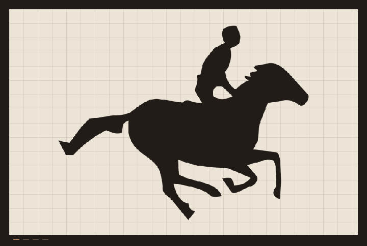

# Stitch Lab

**A vector-to-embroidery editor by Kevin Nomu.** Turn a raster drawing into editable geometry, size it in millimeters, preview the needle path, and export a Janome JEF. I built it within FERVOR to take my own artwork from the screen to the embroidery machine.

[Run the Gallop walkthrough](https://kevinnomu.github.io/stitch-lab/) · [Download the reference JEF](samples/Gallop-90mm.jef?raw=true) · [See the physical sew-out](media/gallop-sewout.png)



Click **Try Gallop**. Trace the silhouette, drag an anchor if you want to change the outline, and send it to Stitch Lab at 90 mm. Play the simulation to see the sewing order, then export and inspect the JEF. You can also start with your own artwork in either editor. Projects save locally in IndexedDB. The interface has Light, Dark, Auto, and a bundled Art theme.

## What the file proves

On the default walkthrough I traced **156 editable nodes**, handed the design to Stitch Lab at a **90 mm target width**, and read back **90.3 × 69.3 mm** and **2,298 needle stitches** from the generated file. A target width sizes the source geometry. Decoded dimensions measure the positions written by the stitch planner and JEF encoder, including travel. The sew-out image shows an earlier Gallop iteration on a Janome Memory Craft 500E. The reference JEF in this repository decodes to 89.9 × 69.2 mm and 2,242 stitches.

I also tested a separate 24-part Vector document through transfer, resize, save, reopen, and JEF export. The [regression test](tests/test_fill_patterns.js) checks the decoded bounds before and after a 100 mm → 90 mm resize. I used this test to catch a case where the size control changed while the exported needle positions stayed at the original scale.

## Code to review

| Part | What to look for |
| --- | --- |
| [JavaScript tracer](source/vector/trace.js) | Raster segmentation, contour extraction, and simplification while retaining holes |
| [Vector editor and handoff](source/vector/vector.js) | Editable Bézier paths, selection, undo, and transfer of geometry into a millimeter-based document |
| [Stitch planning](source/stitch/engine.js) and [JEF codec](source/core/jef.js) | Fill generation, stitch order, hoop checking, and signed 0.1 mm binary movement records |
| [Python API](serve.py) and [independent decoder](jef.py) | Same-origin HTTP endpoint that validates file size, headers, command counts, and dimensions |
| [CSS tokens](source/styles/00-tokens.css) and [editor styles](source/styles/34-editors.css) | Shared themes, layout, buttons, and keyboard focus across the two workspaces |
| [Build script](source/build.py) and [tests](tests/) | Reproducible single-file release, JEF round trips, geometry tests, and HTTP integration tests |

I used Claude Code and Codex as development tools. The validation is in the tests, decoded exports, and machine trials. The browser stack is JavaScript, HTML, CSS, Canvas, SVG, and IndexedDB. The optional local service uses Python’s standard library.

## Run locally

Open `index.html` in a browser, or run `python3 serve.py` and open <http://127.0.0.1:8000/>. The static app uses the JavaScript decoder. The local server adds a Python readback of the same exported bytes. No API keys or packages are required.

```sh
python3 source/build.py --check
python3 -m unittest discover -s tests
for test_file in tests/*.js; do node "$test_file" || exit; done
```

The build check compares `index.html` with its source. To rebuild after an edit, run `python3 source/build.py`. To call the local inspection API directly, start the server and send the file as raw bytes.

```sh
curl -H 'Content-Type: application/octet-stream' \
  --data-binary @samples/Gallop-90mm.jef \
  http://127.0.0.1:8000/api/jef/inspect
```

Built by [Kevin Nomu](https://kevinnomu.com).
